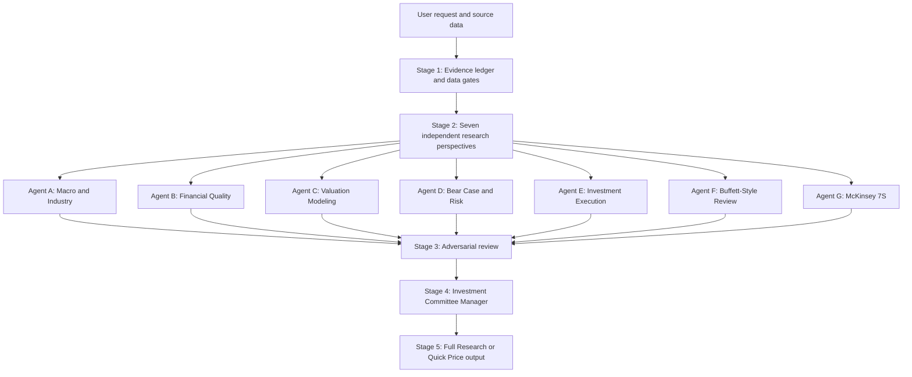

# Equity Research Multi-Agent Framework

A portable, instruction-only Agent Skill for disciplined public-equity research. It combines seven analytical perspectives, an adversarial review, and an Investment Committee Manager while preserving a Buffett-style long-term ownership lens.

The repository contains one English Skill that follows the user's requested output language. It is a research methodology—not a trading system, real-time data service, or multi-model orchestration platform.

## Key Features

- **Seven research perspectives:** macro/industry, financial quality, valuation, bear case, execution, Buffett-style review, and McKinsey 7S.
- **Evidence before conviction:** source hierarchy, claim labels, dated inputs, and explicit data-sufficiency gates.
- **Valuation discipline:** FCFF/FCFE consistency, scenario DCF, sensitivity tables, relative valuation, diluted shares, and margin of safety.
- **Adversarial reasoning:** the Bear Case Agent challenges the assumptions with the greatest valuation impact.
- **Decision-oriented synthesis:** the Manager resolves disagreements by evidence and relevance rather than averaging votes.
- **Two output modes:** Full Research and a strict two-line Quick Price response.
- **Portable design:** Kimi Code first, Codex compatible, and a standalone prompt for other capable LLMs.
- **No runtime dependencies for the Skill:** current research requires the host to provide browsing, filings, or market-data access; supplied-data analysis also works offline.

## Framework Architecture



The seven roles are analytical perspectives. A single LLM simulating them is **not** equivalent to seven independent models or independent executions. The Skill requires the execution method to be disclosed. See [Architecture](docs/architecture.md).

## Repository Structure

```text
equity-research-agent-framework/
├── .agents/skills/equity-research/
│   └── SKILL.md                 # Self-contained reusable Skill
├── prompts/
│   └── equity-research.md       # Standalone prompt for other LLMs
├── docs/
│   ├── architecture.md          # Roles, stages, and committee logic
│   ├── methodology.md           # Evidence, valuation, and risk rules
│   ├── usage.md                 # Installation and invocation
│   └── validation.md            # Executed checks and known test limits
├── examples/
│   └── report-template.md       # Full Research output template
├── tests/
│   ├── fixtures/                # Explicitly hypothetical test inputs
│   └── test_repository.py       # Standard-library structural and DCF tests
├── CHANGELOG.md
├── LICENSE
└── README.md
```

## Quick Start

### Kimi Code

Clone the repository and start Kimi Code from its root. Project Skills under `.agents/skills/` are discovered by scope:

```bash
git clone https://github.com/hql7-luo/equity-research-agent-framework.git
cd equity-research-agent-framework
```

Invoke the Skill with:

```text
/skill:equity-research Analyze <company or ticker> using the latest available filings and a dated market price.
```

For a user-level installation, copy the folder manually:

```bash
mkdir -p ~/.agents/skills
cp -R .agents/skills/equity-research ~/.agents/skills/
```

Start a new Kimi Code session if the Skill is not visible. Manual copying is installation; this project does not claim automatic installation.

### OpenAI Codex

Codex also scans repository and user `.agents/skills/` locations. From the repository root, mention the Skill explicitly:

```text
$equity-research Analyze <company or ticker>.
```

Alternatively, run `/skills` and select `equity-research`. For user-level discovery, copy the Skill to `$HOME/.agents/skills/equity-research/`. Codex normally detects new Skills automatically; restart it if the Skill does not appear.

### Standalone Prompt

Open [`prompts/equity-research.md`](prompts/equity-research.md), copy its complete contents into ChatGPT, Claude, or another capable LLM, and append the research request. No Skill installation is required. The model still needs source documents or research tools for current, verifiable analysis.

## Usage Examples

### Full Research Mode

```text
/skill:equity-research Produce a Full Research report on <company or ticker>. Use the latest regulatory filings, align the market price date with the valuation, and respond in English.
```

Expected structure:

1. Executive Summary
2. Structured Financial Data
3. Valuation & Sensitivity Analysis
4. Seven-Agent Assessments
5. Key Disagreements & Bear Case
6. McKinsey 7S Diagnosis
7. Investment Execution Strategy
8. Manager Final Verdict
9. Sources, Assumptions & Limitations

Use the [report template](examples/report-template.md) as an output outline, not as a source of financial data.

### Quick Price Mode

```text
/skill:equity-research What is a defensible margin-of-safety buy price for <company or ticker>?
```

Output structure when sufficient evidence exists:

```text
1. **Margin-of-Safety Buy Price:** $XX
2. **Core Assumption:** One sentence naming the base intrinsic value and margin-of-safety haircut.
```

If critical data are missing, the Skill returns a brief explanation instead of inventing a price.

### Language Flexibility

English is the default. An explicit request such as `请用简体中文输出完整研报` produces Simplified Chinese without changing formulas, evidence requirements, scenarios, or conclusions. Other languages are followed when the model can support them. There are no language-specific Skill copies.

## Methodology

The workflow has five stages:

1. Collect evidence and apply data-sufficiency gates.
2. Develop seven bounded research perspectives from the shared evidence ledger.
3. Challenge the strongest assumptions and recalculate material sensitivities.
4. Resolve factual, forecast, methodological, and risk disagreements in committee.
5. Produce a transparent report or the strict price-only response.

The valuation framework includes DCF, FCFF/FCFE compatibility, terminal-value checks, enterprise-to-equity reconciliation, dilution, scenario analysis, sensitivity analysis, and relevant multiples. It adapts method selection for financial institutions, cyclical firms, high-growth companies, unprofitable businesses, and conglomerates. See [Methodology](docs/methodology.md).

## Validation

Run the repository checks with Python 3.10+; no third-party packages are required:

```bash
python3 -m unittest discover -s tests -v
```

The tests cover required architecture, Skill/Prompt synchronization, local Markdown links, Mermaid structure, and controlled DCF mathematics using hypothetical inputs. They do not prove live market-data retrieval or native behavior in every host. See [Validation](docs/validation.md) for executed results and untested behavior.

## Known Limitations

- The Skill does not retrieve data by itself. Research quality depends on the host's tools and the user's source material.
- Simulated roles reduce blind spots but do not create statistical independence or eliminate shared model bias.
- DCF outputs are scenario estimates, not predictions or guaranteed returns.
- Public disclosures provide incomplete visibility into organizational culture and execution.
- Quick Price Mode remains dependent on the same valuation evidence gates; brevity does not justify false precision.
- Native Kimi Code and Codex behavior depends on the installed client version. Consult their current official documentation if discovery or invocation changes.

## Official Skill References

- [Kimi Code Agent Skills](https://www.kimi.com/code/docs/en/kimi-code-cli/customization/skills.html)
- [OpenAI: Build Skills](https://learn.chatgpt.com/codex/build-skills)
- [Agent Skills Specification](https://agentskills.io/specification)

## License

[MIT](LICENSE) © 2026 Haoqi Luo.

This project provides general research tooling, not personalized investment advice.
